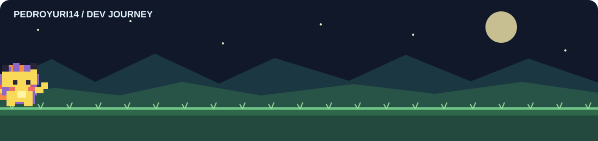
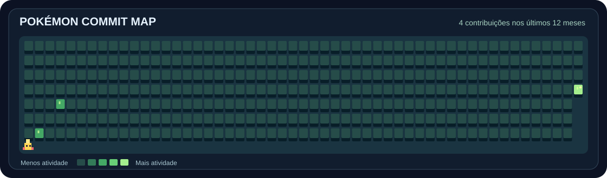

# Olá, eu sou Pedro Yuri! 👋

**Engenharia de Software · Backend · Produtos digitais**

Construo aplicações, automações e produtos que transformam ideias em software.

## 🧑‍💻 Sobre mim

- 🎓 Estudante de **Engenharia de Software**.
- 🛠️ Interesse em **backend, bancos de dados, automação e IA aplicada**.
- 🚀 Desenvolvendo soluções como **TokMerce**, **PetMerce** e integrações empresariais.
- 🌱 Aprendendo continuamente sobre arquitetura de software, cloud e desenvolvimento full stack.

## ⚡ Tecnologias e ferramentas

**Backend e linguagens**

  
  
  
  
  
  

**Frontend**

  
  
  
  
  

**Dados e infraestrutura**

  
  
  
  
  
  
  
  

**Ferramentas**

  
  
  
  
  

Ícones representam tecnologias com as quais já tive contato, que utilizo ou que estou estudando — não indicam o mesmo nível de domínio em todas.

## 🚀 Projetos em destaque

| Projeto | Descrição | Área |
|---|---|---|
| **TokMerce** | Plataforma de inteligência comercial para pesquisa de produtos e tendências. | SaaS · IA · E-commerce |
| **PetMerce** | Sistema de gestão para pet shops, com estoque, clientes, pets e serviços. | ERP · Full stack |
| **Integrador Hiper** | Automação de processos de implantação com Playwright. | Automação · Integrações |

> Adicione links dos repositórios quando estiverem públicos. Não são publicados links fictícios.

## 🗺️ Pokémon Commit Map

Mapa atualizado automaticamente pelo GitHub Actions. Cada bloco corresponde a um dia; terrenos mais intensos representam mais contribuições.

---

**Obrigado pela visita!** ✨

