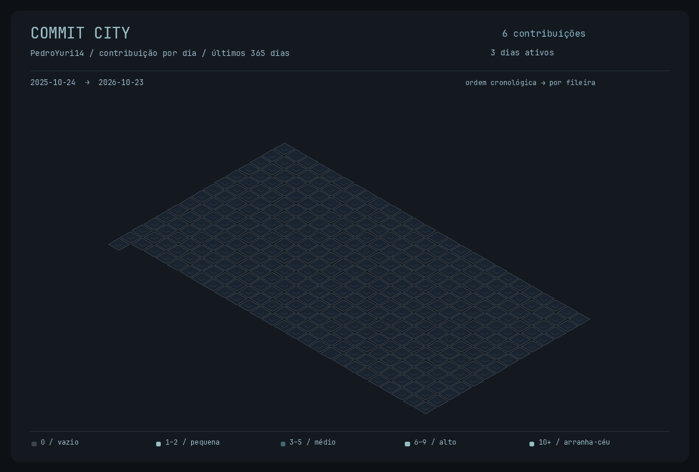

<picture>
  <source media="(prefers-reduced-motion: reduce)" srcset="./assets/animated-java-ide-preview.png" />
  <source media="(max-width: 600px)" srcset="./assets/animated-java-ide-mobile.gif" />
  
</picture>

# Olá, eu sou Pedro Yuri! 👋

**Engenharia de Software · Backend · IA aplicada**

Construo aplicações, automações e produtos que transformam ideias em software.

<a href="./assets/animated-java-ide-preview.png">Ver banner estático</a> · <a href="./animations/java-ide/src/dev/pedroyuri/Developer.java">Código Java do banner</a>

## 🧑‍💻 Sobre mim

- 🎓 Estudante de **Engenharia de Software**.
- 🛠️ Interesse em **backend, bancos de dados, automação e IA aplicada**.
- 🚀 Desenvolvendo soluções como **TokMerce**, **PetMerce** e integrações empresariais.
- 🌱 Aprendendo continuamente sobre arquitetura de software, cloud e desenvolvimento full stack.

## ⚡ Tecnologias e ferramentas

**Backend e linguagens**

  
  
  
  
  
  

**Frontend**

  
  
  
  
  

**Dados e infraestrutura**

  
  
  
  
  
  
  
  

**Ferramentas**

  
  
  
  
  

Ícones representam tecnologias com as quais já tive contato, que utilizo ou que estou estudando — não indicam o mesmo nível de domínio em todas.

## 🚀 Projetos em destaque

| Projeto | Descrição | Área |
|---|---|---|
| **TokMerce** | Plataforma de inteligência comercial para pesquisa de produtos e tendências. | SaaS · IA · E-commerce |
| **PetMerce** | Sistema de gestão para pet shops, com estoque, clientes, pets e serviços. | ERP · Full stack |
| **Integrador Hiper** | Automação de processos de implantação com Playwright. | Automação · Integrações |

Os links dos projetos serão adicionados quando os repositórios estiverem públicos.

## Commit City 3D

<picture>
  <source media="(prefers-reduced-motion: reduce)" srcset="./assets/commit-city.svg" />
  
</picture>

Um terreno por dia. A altura de cada edifício representa contribuições reais do GitHub, incluindo commits e outras atividades contabilizadas no perfil.

| Contribuições no dia | Edifício |
|---|---|
| 0 | Terreno vazio |
| 1–2 | Construção pequena |
| 3–5 | Edifício médio |
| 6–9 | Edifício alto |
| 10+ | Arranha-céu |

[Ver cidade estática](./assets/commit-city.svg) · [Dados do calendário](./assets/commit-city-data.json)

Atualização diária via GitHub Actions. Os dias seguem a ordem cronológica por fileira; o período consultado aparece na imagem.

## Contatos

